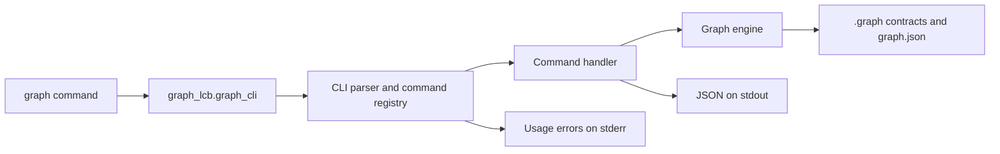

# Architecture

graph-lcb is a synchronous, local CLI. Each invocation loads the contracts and
graph from the current directory's `.graph/` workspace, performs one operation,
and exits. There is no background service, network API, or database.

## Runtime flow

The installed `graph` executable calls
`graph_lcb.graph_cli:main` (configured in `pyproject.toml`). The entry point
imports the command modules so their handlers register with a shared `CLI`
instance. The parser creates a `Context` containing positional arguments and
long-option values, then dispatches the selected handler.

Handlers in `graph_lcb.commands` validate command-specific arguments and call
the graph engine in `graph_lcb.graphs.engine`. The engine owns contract loading,
record validation, mutations, and graph algorithms. Shared helpers in
`graph_lcb.commands.common` handle JSON output and common option parsing.
Detailed, stable command help is maintained in
`graph_lcb.cli.help_texts`.

## Graph model

- **Nodes** represent typed entities and have an ID, type, name, optional
  description, properties, metadata, and evidence.
- **Edges** represent directed relationships between node IDs and have a
  generated UUID, type, properties, metadata, and evidence.
- **Contracts** define the known entity and edge types, allowed properties,
  property types, and permitted source/target entity types for each edge type.

Contracts are workspace-specific. Type names are matched case-insensitively;
new records use the spelling defined in the contract. Edge endpoint types are
checked against the referenced nodes. The contract rules and JSON examples are
described in [Workspace format](./workspace-format.md).

## Read and write behavior

The engine loads the complete JSON graph into typed `Node` and `Edge` records
for an operation. A missing `graph.json` is interpreted as an empty graph.
`graph init` creates the contracts and bundled editor schemas, but does not
create the graph store until the first record is written.

Mutations update the in-memory graph and save the complete store. Saving writes
a temporary file in `.graph/` and replaces `graph.json` with it, avoiding a
partially written store if a process is interrupted during serialization.
There is no file lock or multi-process coordination; avoid running concurrent
commands that write to the same workspace.

`graph import` stages and validates the whole JSONL batch before writing. A
single invalid record prevents the batch from being applied. See
[CLI reference](./cli-reference.md#bulk-import) for the import modes.

## Output boundary

Successful commands emit compact JSON by default. Some commands intentionally
have a textual mode: `graph help`, `graph help COMMAND`, and
`graph contract --compact`. The graph engine raises graph errors; the entry
point reports them on standard error and returns their associated exit code.
`validate` has a structured JSON response for invalid or unavailable workspaces.
